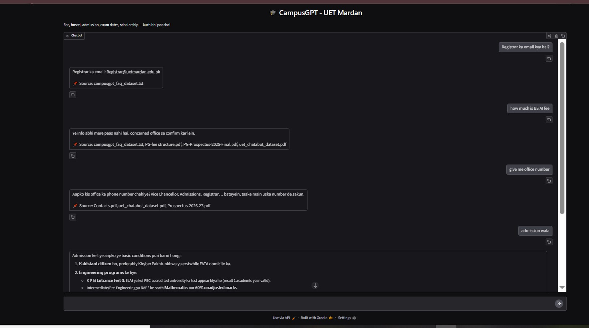
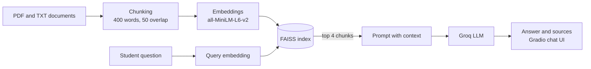

# CampusGPT: A RAG-Based Student Assistant for UET Mardan

[](https://colab.research.google.com/github/YOUR_USERNAME/YOUR_REPO/blob/main/CampusGPT.ipynb)


CampusGPT is a Retrieval-Augmented Generation (RAG) chatbot that answers student questions about the University of Engineering & Technology (UET) Mardan, including fees, hostels, admissions, examination rules, scholarships, and official contacts. Instead of relying on the language model's memory, it retrieves passages from official university documents and answers from that material, citing the source files.

> **Disclaimer:** This is an independent academic project. It is not affiliated with or endorsed by UET Mardan. Answers are generated from publicly available documents and may be outdated or incomplete. Please verify important details with the relevant university office.

## Demo



*The Gradio chat interface. Each answer lists the documents it was drawn from.*

| Example question | What the assistant does |
|---|---|
| `Registrar ka email kya hai?` | Returns the Registrar's official email, sourced from the FAQ dataset |
| `admission wala` | Summarizes admission eligibility conditions from the prospectus |
| `give me office number` | Asks which office is needed (Vice Chancellor, Admissions, Registrar) before answering |

## Features

- **Grounded answers:** responses are generated only from retrieved document passages
- **Source attribution:** every reply names the documents it used
- **Safe fallback:** when the answer is not in the documents, the assistant says so instead of guessing
- **Mixed-language input:** handles English and Roman Urdu questions
- **Resilient API calls:** request timeout and retry handling
- **Free to run:** built entirely on free tools (Google Colab, Groq free tier, open-source models)

## How It Works



1. **Ingestion:** PDFs and text files are read and split into overlapping chunks.
2. **Embedding:** each chunk is converted to a vector with `all-MiniLM-L6-v2` (Sentence-Transformers).
3. **Indexing:** vectors are stored in a FAISS index (`IndexFlatL2`).
4. **Retrieval:** the 4 chunks most similar to the question are retrieved.
5. **Generation:** the retrieved context and the question are sent to an LLM through the Groq API. The prompt restricts the model to the supplied context and tells it not to guess numbers or dates.
6. **Interface:** a Gradio chat UI displays the answer and its sources.

## Tech Stack

| Component | Tool |
|---|---|
| Language / environment | Python, Google Colab |
| Document parsing | pypdf |
| Embeddings | Sentence-Transformers (`all-MiniLM-L6-v2`) |
| Vector search | FAISS (CPU) |
| LLM | Groq API (default model: `openai/gpt-oss-120b`) |
| User interface | Gradio |

## Dataset

The knowledge base is built from official, publicly available UET Mardan documents plus a compiled FAQ file:

- Undergraduate prospectus 2026-27 and postgraduate prospectus 2025
- Undergraduate and postgraduate fee structures
- Academic calendars (undergraduate, postgraduate, and summer)
- Hostel admission and regulations
- Examination rules and eligibility criteria
- Postgraduate scholarships
- University contacts, clubs and societies, and Center of AI information
- `campusgpt_faq_dataset.txt`: a question-and-answer file compiled from the documents above

The source PDFs are not included in this repository (some exceed GitHub's 100 MB file limit, and they are the university's documents). Download them from the official UET Mardan website and place them in your data folder.

## Getting Started

### Prerequisites

1. A free **Groq API key** from https://console.groq.com/keys
2. A Google account (for Google Colab and, optionally, Google Drive)

### Setup

1. Open `CampusGPT.ipynb` in Google Colab (use the badge at the top of this page).
2. Add your key as a Colab Secret: click the key icon in the left sidebar, add a secret named `UETchatbot` with your Groq key as the value, and turn on **Notebook access**.
3. Put your dataset files (PDFs and `.txt`) in a Google Drive folder, then set `DATA_FOLDER` in Step 3 to that folder's path, for example `/content/drive/MyDrive/UET chatbot`.
4. Run the cells from top to bottom. Step 9 launches the chat interface.

To get a temporary public link for sharing a demo, change `share=False` to `share=True` in the final `demo.launch(...)` call.

## Project Structure

```
.
├── CampusGPT.ipynb        # Full pipeline: ingestion, indexing, retrieval, chat UI
├── assets/
│   └── demo.jpg           # Screenshot used in this README
├── campusgpt_faq_dataset.txt   # Compiled FAQ (optional to include)
└── README.md
```

## Security

The API key is read from Colab Secrets and is never stored in the notebook, so the notebook can be shared or published without exposing it. Never paste a key directly into a cell, and clear notebook outputs before committing.

## Limitations

- Knowledge is limited to the documents provided. Library rules, transport schedules, the faculty directory, and exam datesheets are not yet covered.
- Fees and academic calendars change over time, so the source documents must be kept up to date.
- Retrieval uses an English-focused embedding model over mixed English and Roman Urdu text, so some questions (for example, certain English fee questions) may fail to retrieve the right passage and return the fallback answer.
- The assistant does not keep conversation history; each question is answered independently.
- Replies tend to follow the Roman Urdu style of the system prompt, even for some English questions.

## Future Work

- Switch to a multilingual embedding model and add hybrid (keyword plus vector) search to improve retrieval
- Add conversation memory for follow-up questions
- Build an evaluation set of 20 to 30 questions to measure answer accuracy
- Expand the dataset (library, transport, faculty directory, exam datesheets)
- Deploy permanently on Hugging Face Spaces
- Add a "Was this helpful?" feedback option

## Author

**Abdullah Hasan Shah**
[LinkedIn](https://www.linkedin.com/in/abdullah-hasan-shah-b306b6370/)
